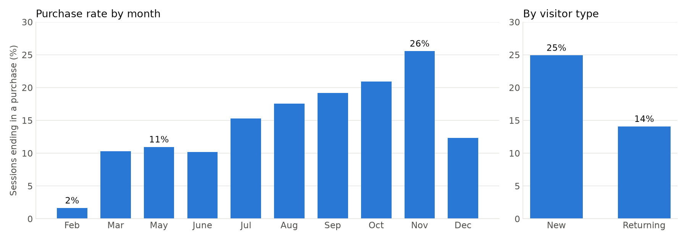
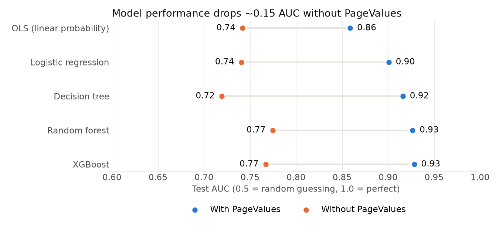
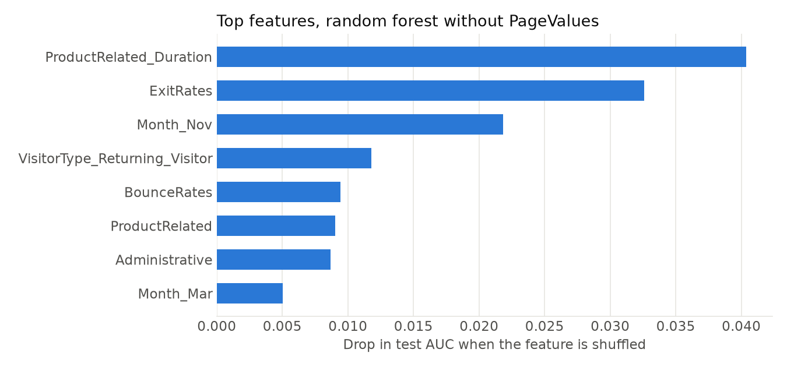

# Online Shopper Purchase Prediction

Which browsing behaviors are associated with an online purchase, and how well can a session's outcome be predicted?
This project analyzes 12,000+ e-commerce sessions with exploratory analysis, regression (OLS and logit), and four machine learning models.

## Key visualizations

**Purchases peak in November, and new visitors convert more often than returning visitors.**



**Every model loses about 0.15 AUC without `PageValues`, a metric built from purchase revenue.** Model choice matters much less than this one feature.



**Without `PageValues`, time on product pages, exit rate, and November drive the best model's predictions.**



*Purchase rates use all sessions after removing duplicates and "Other" visitors. Figures are generated by `make_figures.py`.*

## Data
[Online Shoppers Purchasing Intention Dataset](https://archive.ics.uci.edu/dataset/468/online+shoppers+purchasing+intention+dataset) (UCI Machine Learning Repository; Sakar et al., 2018; CC BY 4.0).
12,330 sessions over 10 months of one year; outcome `Revenue` = whether the session ended in a purchase (~15% did).

## Approach
1. **EDA** (`01_eda.ipynb`; EDA-only version: `01_eda_only.ipynb`): purchase rates by month and visitor type, browsing behavior, correlation analysis, and OLS / logistic regressions of purchase on bounce rate, browse time, visitor type, and other session features.
2. **Modeling** (`02_modeling.ipynb`):
   - Primary model: OLS linear probability model with robust (HC1) standard errors
   - Compared with logistic regression, decision tree, random forest, and XGBoost
   - One stratified 80/20 train/test split; 5-fold cross-validated AUC on the training set
   - Class weighting for the imbalanced outcome; evaluated with AUC, precision, recall, F1
   - Every model run **with and without `PageValues`**, a Google Analytics metric computed from purchase revenue (leakage risk)

## Results (test set)

| Model | AUC with PageValues | AUC without PageValues |
|---|---|---|
| OLS (linear probability) | 0.859 | 0.742 |
| Logistic regression | 0.901 | 0.740 |
| Decision tree | 0.916 | 0.719 |
| Random forest | 0.927 | 0.775 |
| XGBoost | 0.928 | 0.767 |

**Key findings**
- `PageValues` drives most of the predictive power: removing it lowers AUC by about 0.15 for every model, which reflects that it is built from purchase outcomes.
- Without `PageValues`, the tree-based models outperform OLS and logistic regression by only about 0.03 AUC; feature choice matters more than model choice.
- The strongest remaining signals are exit rate, time spent on product pages, November seasonality, and visitor type (new visitors convert at higher rates than returning visitors).

## How to run
```bash
conda create -n ecommerce python=3.12
conda activate ecommerce
pip install -r requirements.txt
jupyter notebook
```
